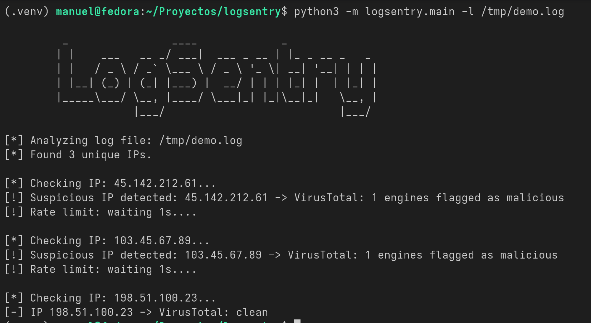
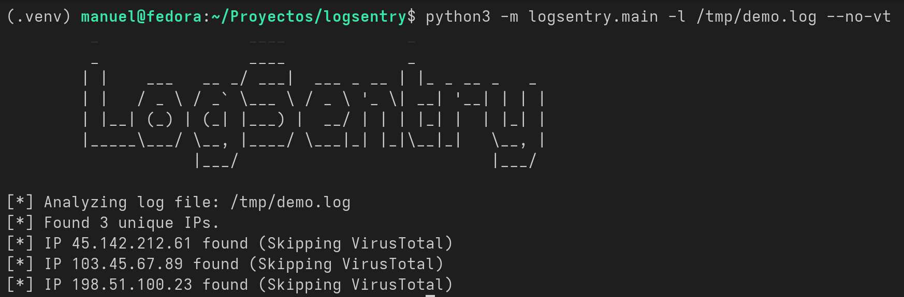
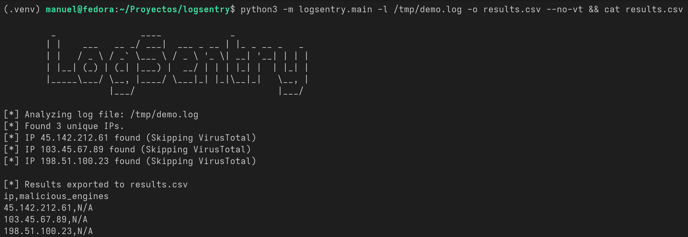
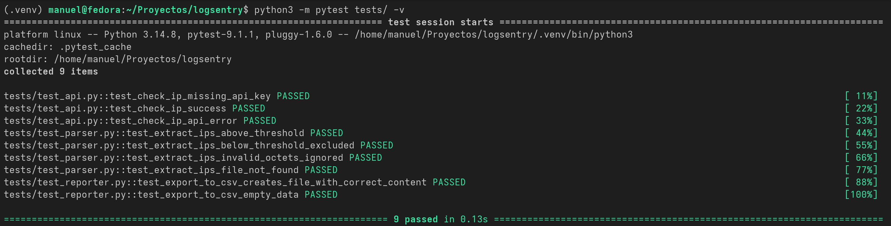

# 🛡️ LogSentry

LogSentry is a Python-based security command-line tool designed to parse log files, extract suspicious IP addresses based on occurrence thresholds, and analyze them using the VirusTotal v3 API. 

## ✨ Features

* **Strict Parsing:** Utilizes robust regular expressions to extract only valid IPv4 addresses.
* **Failed-Login Detection:** Only counts IPs from failed authentication attempts (`Failed password`, `Invalid user`), so successful logins never trigger false positives.
* **Threshold Control:** Filters out noise by only analyzing IPs that exceed a user-defined threshold of occurrences.
* **VirusTotal Integration:** Automatically checks suspicious IPs against multiple security engines to determine if they are malicious.
* **Rate Limit Aware:** Smartly handles VirusTotal's public API limits (4 requests/min) with built-in delays, preventing account bans.
* **Local Mode:** Includes a `--no-vt` flag for fast, local-only parsing without making any API calls.
* **CSV Export:** Export scan results to a CSV file for further analysis or record-keeping.

## ⚙️ Prerequisites

* Python 3.9 or higher.
* A [VirusTotal API Key](https://www.virustotal.com/) (the free tier is fully supported).

## 🚀 Installation

1. **Clone the repository:**
   ```bash
   git clone [https://github.com/lagunamanuel/logsentry.git](https://github.com/lagunamanuel/logsentry.git)
   cd logsentry
   ```

2. **Create and activate a virtual environment (recommended):**
   ```bash
   python3 -m venv .venv
   source .venv/bin/activate
   ```

3. **Install LogSentry:**
   ```bash
   pip install .
   ```
   This installs the dependencies and registers the `logsentry` command.

4. **Set up your environment variables:**
   You must export your VirusTotal API key before running the tool:
   ```bash
   export VT_API_KEY="your_api_key_here"
   ```
   *(Tip: You can add this line to your `~/.bashrc` or `~/.zshrc` to make it persistent).*

### Install globally (optional)

To use `logsentry` from any terminal without activating a virtual environment, install it with [pipx](https://pipx.pypa.io/):

```bash
pipx install .
```
## 🛠️ Usage

Run the script by pointing it to a log file. By default, it will look for IPs with at least 5 occurrences.

```bash
logsentry -l /path/to/your/test.log
```

### Arguments

| Argument | Short | Description |
| :--- | :--- | :--- |
| `--log` | `-l` | **(Required)** Path to the log file to analyze. |
| `--threshold`| `-t` | Minimum number of occurrences to consider an IP suspicious (Default: 5). |
| `--no-vt` | | Skip VirusTotal API lookups (local parsing only). |
| `--premium` | | Skip the 15-second rate limit delay (only if you have a Premium VT API Key). |
| `--output` | `-o` | Export results to a CSV file with the given filename. |

### Examples

**1. Basic scan with a custom threshold of 10:**
```bash
logsentry -l auth.log -t 10
```

**2. Fast local parsing (no API calls):**
```bash
logsentry -l auth.log --no-vt
```

**3. Scan and export results to CSV:**
```bash
logsentry -l auth.log -o results.csv
```
## 📸 Screenshots

### Full scan with VirusTotal


### Local mode (no API calls)


### CSV export


### Test suite

## 🧪 Testing

LogSentry has a full unit test suite covering the parser, API client and reporter modules, using `pytest` and mocked HTTP requests (no network access or API quota consumed during tests).

```bash
pip install pytest
python3 -m pytest tests/ -v
```
## ⚠️ Known Limitations

* **SSH-style logs only:** failed attempts are recognised by the markers `Failed password` and `Invalid user`. Logs from other services (nginx, Apache...) are not matched yet.
* **Possible double counting:** sshd can log two lines for a single attempt against a non-existent user (`Invalid user ...` and `Failed password for invalid user ...`), so that attempt counts twice towards the threshold.
* **IPv4 only:** IPv6 addresses are not detected.

## 🗺️ Roadmap

- [x] **Phase 1:** Core CLI structure and VirusTotal API integration.
- [x] **Phase 2:** Argument parsing, rate-limit handling, and architecture refactoring.
- [x] **Phase 3:** CSV export for scan results.
- [ ] **Phase 4:** Smart log parsing (e.g., distinguishing between failed SSH logins and generic errors).
- [ ] **Phase 5:** JSON export format for SIEM ingestion.
- [x] **Phase 6:** Installable as a `logsentry` command (pip/pipx) with wheel published in GitHub Releases.
- [ ] **Phase 7:** Publish to PyPI.
## 📄 License

This project is licensed under the GNU General Public License v3.0 - see the [LICENSE](LICENSE) file for details.