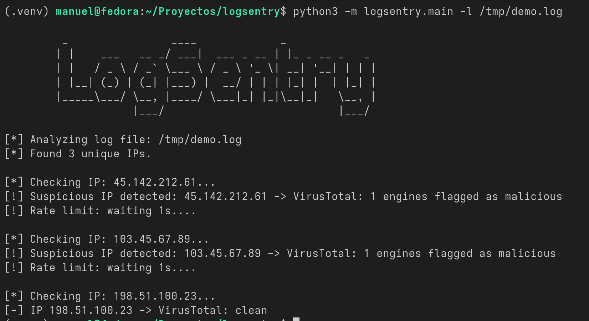
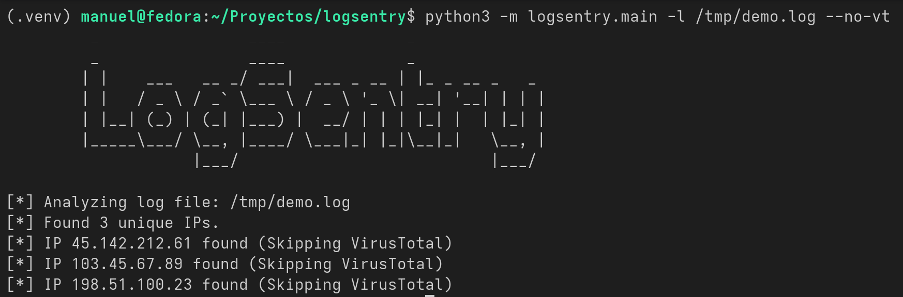
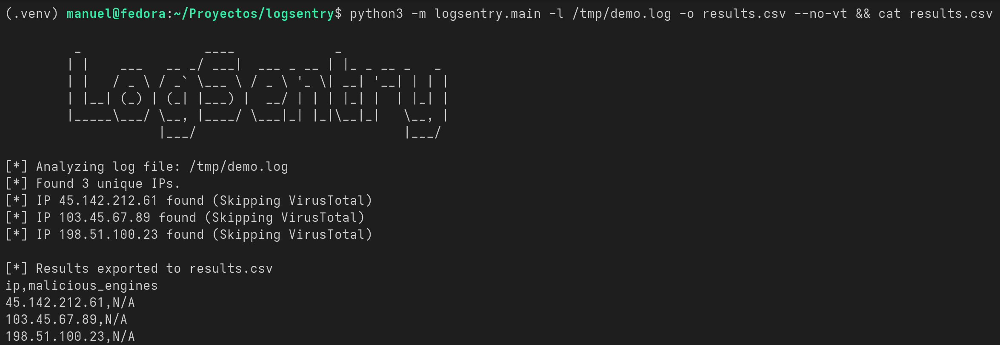
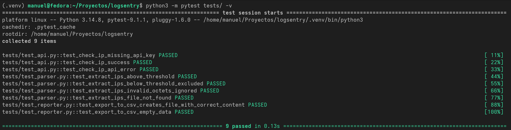

# 🛡️ LogSentry

LogSentry is a Python-based security command-line tool designed to parse log files, extract suspicious IP addresses based on occurrence thresholds, and analyze them using the VirusTotal v3 API. 

## ✨ Features

* **IPv4 Extraction:** Extracts IPv4 addresses from supported SSH authentication logs.
* **Failed-Login Detection:** Counts failed password and invalid-user log entries by default. Time-window mode uses structured failed SSH authentication events.
* **Threshold Control:** Flags IPs that meet or exceed a user-defined occurrence threshold.
* **Time-Window Detection:** Optionally require the threshold to be reached per IP within a configurable number of seconds using `--window`.
* **VirusTotal Integration:** Automatically checks suspicious IPs against multiple security engines to determine if they are malicious.
* **Private IP Handling:** Private, loopback and reserved addresses are still listed in the output and the CSV, but are never sent to VirusTotal, saving API quota and avoiding misleading "clean" results.
* **Rate Limit Aware:** Smartly handles VirusTotal's public API limits (4 requests/min) with built-in delays, preventing account bans.
* **Local Mode:** Includes a `--no-vt` flag for fast, local-only parsing without making any API calls.
* **CSV Export:** Export scan results to a CSV file for further analysis or record-keeping.

## ⚙️ Prerequisites

* Python 3.9 or higher.
* A [VirusTotal API Key](https://www.virustotal.com/) for online lookups. Not required with `--no-vt`.

## 🚀 Installation

1. **Clone the repository:**
   ```bash
   git clone https://github.com/lagunamanuel/logsentry.git
   cd logsentry
   ```

2. **Create and activate a virtual environment (recommended):**
   ```bash
   python3 -m venv .venv
   source .venv/bin/activate
   ```

3. **Install LogSentry:**
   ```bash
   pip install .
   ```
   This installs the dependencies and registers the `logsentry` command.

4. **Set up your environment variables:**
   For VirusTotal lookups, export your API key before running the tool. Skip this step when using `--no-vt`:
   ```bash
   export VT_API_KEY="your_api_key_here"
   ```
   *(Tip: You can add this line to your `~/.bashrc` or `~/.zshrc` to make it persistent).*

### Install globally (optional)

To use `logsentry` from any terminal without activating a virtual environment, install it with [pipx](https://pipx.pypa.io/):

```bash
pipx install .
```
## 🛠️ Usage

Run the script by pointing it to a log file. By default, it will look for IPs with at least 5 occurrences.

```bash
logsentry -l /path/to/your/test.log
```

### Arguments

| Argument | Short | Description |
| :--- | :--- | :--- |
| `--log` | `-l` | **(Required)** Path to the log file to analyze. |
| `--threshold`| `-t` | Minimum number of occurrences to consider an IP suspicious (Default: 5). |
| `--window` | `-w` | Require the threshold per IP within this many seconds. Must be a positive integer. Disabled by default. |
| `--no-vt` | | Skip VirusTotal API lookups (local parsing only). || `--premium` | | Skip the 15-second rate limit delay (only if you have a Premium VT API Key). |
| `--output` | `-o` | Export results to a CSV file with the given filename. |

### Examples

**1. Basic scan with a custom threshold of 10:**
```bash
logsentry -l auth.log -t 10
```

**2. Fast local parsing (no API calls):**
```bash
logsentry -l auth.log --no-vt
```

**3. Scan and export results to CSV:**
```bash
logsentry -l auth.log -o results.csv
```
**4. Detect at least 5 failed-login events per IP within 60 seconds:**
```bash
logsentry -l auth.log -t 5 -w 60 --no-vt
```

### Time-window detection

Without `--window`, LogSentry preserves its existing whole-file occurrence counting.

With `--window SECONDS` (or `-w SECONDS`):
* Failed SSH authentication events are grouped by source IP.
* Any group reaching the threshold within the window is detected, even if log entries are out of chronological order.
* The boundary is inclusive: 5 events spanning exactly 60 seconds match `-t 5 -w 60`.
* Successful authentication events do not count.
* Events without a parseable timestamp are excluded. LogSentry does not fall back to whole-file counting.
* Both `--window` and `--threshold` must be positive integers.

Supported timestamps:
* Classic syslog: `Jul 20 08:12:01`
* ISO 8601: `2026-07-20T08:12:01`, optionally with fractional seconds and a timezone offset or `Z`.

## 📸 Screenshots

### Full scan with VirusTotal


### Local mode (no API calls)


### CSV export


### Test suite

## 🧪 Testing

LogSentry includes tests for the parser, API client, reporter and CLI, including local scans and CSV export with and without time-window detection. HTTP requests are mocked, so tests do not require network access or consume API quota.
```bash
pip install pytest
python3 -m pytest tests/ -v
```
## ⚠️ Known Limitations

* **SSH-style logs only:** the default mode recognises the markers `Failed password` and `Invalid user`. Window mode requires structured SSH authentication lines. Other services such as nginx or Apache are not supported.
* **Possible double counting:** sshd can log two lines for a single attempt against a non-existent user (`Invalid user ...` and `Failed password for invalid user ...`), so that attempt counts twice towards the threshold in both modes.
* **IPv4 only:** IPv6 is not supported.
* **Syslog date assumptions:** classic syslog timestamps contain no year or timezone. The current year is assumed; year rollover across December and January is not inferred.
* **Timezone ambiguity:** in window mode, mixing timestamps with and without timezone information for the same source IP is rejected. No timezone is guessed for naive timestamps.
* **Timestamp precision:** events sharing the same timestamp are counted separately. This does not resolve the possible double counting described above.

## 🗺️ Roadmap

- [x] **Phase 1:** Core CLI structure and VirusTotal API integration.
- [x] **Phase 2:** Argument parsing, rate-limit handling, and architecture refactoring.
- [x] **Phase 3:** CSV export for scan results.
- [ ] **Phase 4:** Smart log parsing
  - [x] Count only failed login attempts (`Failed password`, `Invalid user`)
  - [ ] Avoid double counting of a single attempt against an invalid user
  - [x] Skip private/reserved IPs in VirusTotal lookups
  - [ ] Report targeted usernames per IP
  - [x] Time-window detection (N failures within M seconds)
  - [x] Structured event parsing (timestamp, username, event type)
- [ ] **Phase 5:** JSON export format for SIEM ingestion.
- [x] **Phase 6:** Installable as a `logsentry` command (pip/pipx) with wheel published in GitHub Releases.
- [ ] **Phase 7:** Publish to PyPI.
- [ ] **Phase 8 (research):** Behaviour-based anomaly detection with an optional local ML model
  - [ ] Per-IP feature extraction (failures, distinct usernames, time between attempts)
  - [ ] Evaluate against the rule-based detector on labelled data
  - [ ] Optional install: `pip install logsentry[ml]`
## 📄 License

This project is licensed under the GNU General Public License v3.0 - see the [LICENSE](LICENSE) file for details.